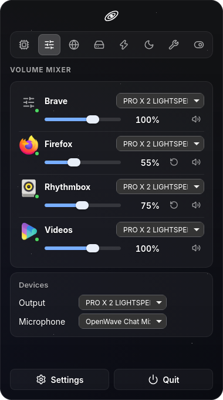
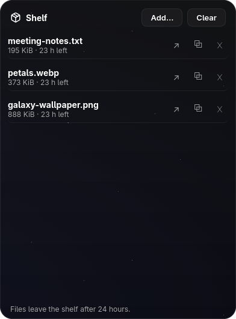
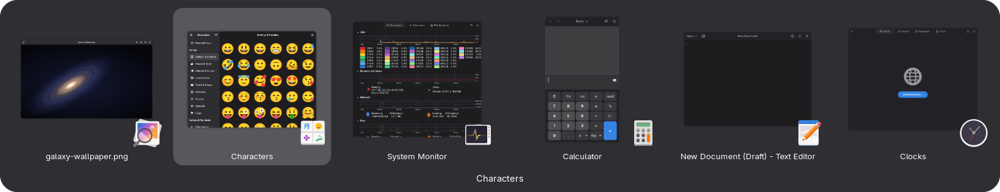

<div align="center">


### Your whole system, one click away.

Temperatures, every GPU, per-app volume, clipboard history, screen text and file conversion<br>
in one glass panel under one icon in the GNOME top bar.

[](../../releases)
[](../../actions/workflows/ci.yml)
[](LICENSE)


**[Website](https://incept0s.github.io/andromeda/)** ·
[Install](#install) ·
[Tour](#a-quick-tour) ·
[Shortcuts](#keyboard-shortcuts) ·
[Help](#troubleshooting)

</div>

<table>
  <tr>
    <td></td>
    <td></td>
    <td></td>
  </tr>
</table>

## Install

Fedora **44+** with GNOME **50** on Wayland. Download the RPM from the
[latest release](../../releases/latest), then:

```bash
sudo dnf install ./andromeda-*.rpm
```

1. Log out and back in (GNOME on Wayland loads new extensions only at login).
2. Open the **Extensions** app and switch on **Andromeda**.
3. Optional frosted blur: in [Blur My Shell](https://extensions.gnome.org/extension/3193/blur-my-shell/)
   → **Applications**, add `andromeda` to the whitelist.

<details>
<summary><b>Build from source</b></summary>

```bash
git clone https://github.com/Incept0s/andromeda.git
cd andromeda
scripts/install.sh
```

The script installs the build tools (Rust with the WebAssembly target,
[Trunk](https://github.com/trunk-rs/trunk), WebKitGTK headers), builds an RPM
and installs it. Run it again to update; your settings are kept.
</details>

Uninstall with `sudo dnf remove andromeda`.

## A quick tour

### The panel

Click the icon or press <kbd>Super</kbd>+<kbd>A</kbd>. Eight tabs, in the order the panel shows them:

| Tab | What it does |
|-----|--------------|
| **System** | CPU per core, every GPU (AMD and Intel via the kernel, NVIDIA via its driver), memory and pressure, temperatures, fans, battery health, live graphs |
| **Volume mixer** | Volume per app with boost above 100 %, mute, a different speaker or headset per app, system output and microphone |
| **Network** | Live speed, session totals, interfaces and addresses, apps with open connections, speed test on demand |
| **Disks** | Space per volume, read and write speed, drive health (SMART), eject |
| **Energy** | Battery and power flow, power mode, mouse and headset batteries, busiest apps |
| **Keep awake** | No suspend or screen blanking for a set time, optionally with the lid closed; stops on its own when the battery runs low |
| **Tools** | Clipboard history (text and images), copy text from screen (OCR, QR codes), color picker, file converter, cleaner, RPM and Flatpak packages, shelf |
| **Controls** | Quick switches for the background features |

Settings (bottom left of the panel) has the same glass look and holds
everything else. Every feature can be switched off there; missing hardware or
tools only hide what needs them, and Settings → System check lists what was found.

### The top bar

<p align="center"></p>

- **Live numbers** such as `CPU 42°  RAM 61%  12W`. Pick them and their order
  in Settings → Top bar; put them right of the clock or at the far left.
- **Shelf** (box icon): drop files on it to park them, click it to drag them
  out again. Entries leave after 24 hours (configurable). Links only; nothing
  is copied or moved.
- **Converter** (optional): drop a file on the icon to convert it to WebP,
  JPEG, MP3, GIF or PDF, or to compress it.
- **Clipboard** (optional): your recent copies, images included; click one to
  copy it again.

<p align="center"></p>

### Alt+Tab and alerts

<p align="center"></p>

Large live previews, one per window, minimized ones included, grouped by app,
each with its title. Hold <kbd>Alt</kbd>, press <kbd>Tab</kbd> to move,
<kbd>W</kbd> to close a window, release to switch.

**Alerts** arrive as GNOME notifications when a reading stays past a limit you
set: CPU temperature, low battery, a nearly full disk, any sensor you choose.

## Keyboard shortcuts

Work in every app; change them in Settings → Shortcuts.

| Shortcut | Action |
|----------|--------|
| <kbd>Super</kbd>+<kbd>A</kbd> | Show or hide the panel |
| <kbd>Super</kbd>+<kbd>Shift</kbd>+<kbd>T</kbd> | Copy text (or a QR code) from a screen area |
| <kbd>Super</kbd>+<kbd>Shift</kbd>+<kbd>C</kbd> | Pick a color; its hex code is copied |
| <kbd>Super</kbd>+<kbd>Shift</kbd>+<kbd>K</kbd> | Keep awake on/off |
| <kbd>Super</kbd>+<kbd>Shift</kbd>+<kbd>M</kbd> | Microphone mute on/off |

Super+A is GNOME's "Show apps" shortcut by default; Andromeda borrows it while
the extension is on and gives it back when it is turned off.

## Privacy

- **Nothing leaves your computer on its own.** The network is used only for the
  speed test (Cloudflare) and package operations you start.
- **Clipboard history stays local**, readable by you only. Copies that password
  managers mark as secret are never stored.
- **Copy text from screen** deletes its temporary screenshot right after reading it.
- **No permanent root.** A password is asked only for package changes
  (PackageKit) and the cleaner's system items (`pkexec`, fixed command list).

Security issues: see [SECURITY.md](SECURITY.md).

## Troubleshooting

<details>
<summary><b>The icon does not appear</b></summary>

Log out and back in, then switch Andromeda on in the Extensions app.
</details>

<details>
<summary><b>A tab is empty or says "not available"</b></summary>

Settings → System check shows which sensor, service or tool is missing and how
to get it.
</details>

<details>
<summary><b>The desktop misbehaves after enabling the extension</b></summary>

Switch to a text console with <kbd>Ctrl</kbd>+<kbd>Alt</kbd>+<kbd>F3</kbd>, log in and run:

```bash
systemctl --user stop andromedad
gnome-extensions disable andromeda@incept0s.github.io
```

Then return with <kbd>Ctrl</kbd>+<kbd>Alt</kbd>+<kbd>F2</kbd>, log out and back in.
</details>

<details>
<summary><b>Reporting a bug</b></summary>

[Open an issue](../../issues/new/choose) and attach
`journalctl --user -b | grep -i andromeda`. For missing or wrong sensors, also
attach the output of `cargo run -p andromeda-core --example probe` from a
source checkout.
</details>

## Under the hood

<details>
<summary><b>How it works</b></summary>

```
GNOME Shell extension (JS)  ──┐
                              ├── D-Bus ──  andromedad (Rust)  ──  /proc, /sys, PipeWire, NVML,
Panel: Tauri + Leptos (Rust) ─┘                                    UDisks2, PackageKit, portals
```

- **`andromedad`** does all measuring and every job, at about 0.2 % of one CPU
  core. It samples once per second and publishes everything on the session
  bus. Expensive readings (NVIDIA, drive and Wi-Fi temperatures) only run
  often while someone looks.
- **The panel** is a [Tauri](https://tauri.app) app whose UI is written in Rust
  with [Leptos](https://leptos.dev) and compiled to WebAssembly. It only
  displays, and exits a few minutes after it is closed.
- **The Shell extension** is kept minimal: it draws the top-bar items, places
  the panel under its icon, forwards clipboard changes, registers shortcuts and
  extends GNOME's own Alt+Tab. It stores nothing.
</details>

<details>
<summary><b>Requirements</b></summary>

| | |
|---|---|
| Required | Fedora 44+, GNOME 50, Wayland, PipeWire |
| Pulled in by the RPM | WebKitGTK, ffmpeg (`ffmpeg-free` works; RPM Fusion's adds H.264), Tesseract (English), curl |
| Used when present | LibreOffice, Flatpak, PackageKit, UDisks2, power-profiles-daemon or tuned-ppd, Blur My Shell |

There is no Flatpak and none is planned: a sandboxed app cannot read hardware
sensors, change other apps' volume or ship a Shell extension.
</details>

<details>
<summary><b>Configuration and data</b></summary>

| Path | Contents |
|------|----------|
| `~/.config/io.github.incept0s.Andromeda/config.toml` | Settings (editable by hand; an unreadable file is moved to `config.toml.bad`) |
| `~/.local/share/io.github.incept0s.Andromeda/` | Clipboard history, clipboard images, shelf; readable by you only |
</details>

## Project status

**0.1.0 is a pre-release**, in daily use on Fedora 44 / GNOME 50 (AMD Radeon
610M + NVIDIA RTX 5070 Ti laptop). Intel GPUs and desktops without a battery
are untested; reports are welcome.

Open issues: [#2](../../issues/2) dragging files out of the shelf into Files
is inconsistent · [#3](../../issues/3) the clipboard window does not work
properly · [#4](../../issues/4) readings not yet verified one by one against
reference tools.

Planned: [#5](../../issues/5) icons instead of text labels (CPU, RAM, …) for
the live numbers in the top bar · [#6](../../issues/6) Alt+Tab wraps into rows
instead of scrolling when many windows are open · [#7](../../issues/7) many
more converter formats (Markdown, SVG, HEIC, PDF tools, batches).

Known limits: Linux has no per-app energy figure, so the Energy tab ranks apps
by CPU use; per-app network traffic needs root, so the Network tab counts open
connections.

## Contributing

Bug reports and patches are welcome. [CONTRIBUTING.md](CONTRIBUTING.md) covers
building, testing the extension safely in a nested session, and the project's
rules.

## License

Copyright © 2026 Incept0s. Licensed under the **GNU General Public License
v3.0 or later**; see [LICENSE](LICENSE). Third-party components are listed in
[THIRD-PARTY.md](THIRD-PARTY.md) and [THIRD-PARTY-LICENSES.md](THIRD-PARTY-LICENSES.md).

Inspired by [Vorssaint Utils](https://github.com/vorssaint/vorssaint-utils);
not affiliated with or endorsed by Vorssaint. Two small pieces of logic are
adapted from its GPL-3.0-or-later source and marked as modified (see
THIRD-PARTY.md); everything else is a new implementation.
