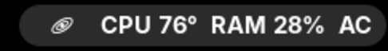

<div align="center">


[](../../releases)
[](LICENSE)
[](https://fedoraproject.org/)
[](https://www.gnome.org/)
[](https://wayland.freedesktop.org/)
[](../../actions/workflows/ci.yml)

[](https://skillicons.dev)

</div>

## What this is

On macOS, one menu-bar utility can show your temperatures, set the volume of
every app on its own, keep the computer awake, remember your clipboard and
pull text out of a screenshot. **Andromeda brings that to GNOME:** one icon in
the top bar with a few live numbers next to it, and a panel underneath with
everything else.

It is made for **Fedora GNOME on Wayland** and nothing else, so it can use
what that desktop really offers: PipeWire for audio, systemd and D-Bus for
services, GNOME Shell for the top bar and Alt+Tab. No tray-icon workaround,
no X11 fallback.

**Light when you are not looking.** A small background service does the
measuring, at about 0.2 % of one CPU core and 28 MB of memory. The panel only
runs while it is open and quits a few minutes after you close it.

## What you get

| Tab | What it shows or does |
|-----|------------------------|
| **Keep awake** | Stops suspend and screen blanking for 15 minutes up to "until I turn it off"; ends on its own when the battery runs low |
| **Volume mixer** | Volume per app with boost above 100 %, mute, a different speaker or headset per app, system output and microphone |
| **System** | CPU, every GPU (AMD and Intel from the kernel, NVIDIA through its driver), memory and memory pressure, temperatures, fans, battery health, uptime, live graphs |
| **Network** | Live speed, session totals, interfaces and addresses, apps with open connections, a speed test on demand |
| **Disks** | Space per volume, read and write speed, drive health (SMART), eject |
| **Energy** | Battery and power flow, power mode, mouse and headset batteries, the apps using the most CPU |
| **Tools** | Clipboard history, copy text from the screen (OCR and QR codes), color picker, file converter, cleaner, packages (RPM and Flatpak), a shelf for files |
| **Controls** | Quick switches for the app switcher and the background features |

And outside the panel:

- **Numbers in the top bar.** Plain text, no graphs, e.g. `CPU 42°  RAM 61%  12W`.
  Choose and order them in Settings → Top bar, and put them right of the
  clock or at the far left of the bar.
- **A shelf in the top bar.** Drag files from any app onto the box icon to
  park them; click the box and drag them out again into Files, a browser or
  a chat. Files leave the shelf after 24 hours (or 1 hour, or never), and a
  Clear button empties it. The shelf only links to your files, it never
  copies or moves them.
- **Alt+Tab with large previews.** One live preview per window, minimized
  windows included, grouped by app.
- **Alerts.** A GNOME notification when a reading stays past a limit you set:
  CPU temperature, low battery, a nearly full disk, any sensor you like.

Every feature can be switched off in Settings → Features. Missing hardware or
tools only hide what needs them; Settings → System check shows what was found.

<div align="center">

</div>

## The look

Panel and Settings share one frosted-glass style, the same recipe as a glass
GNOME Shell setup: a dark tint that runs from `rgba(37,37,37,.42)` to
`rgba(13,13,13,.39)`, a 1px light edge, white text with a soft shadow, rounded
corners on one consistent scale.

The blur behind the glass comes from
[Blur My Shell](https://extensions.gnome.org/extension/3193/blur-my-shell/):
open its settings, go to **Applications**, and add `andromeda` to the
whitelist. Without it the panel still works, it is just more see-through.

## Install

Every [release](../../releases) has an RPM.

| Format | For | Install |
|--------|-----|---------|
| **RPM** | Fedora 44+ with GNOME 50 | `sudo dnf install ./andromeda-*.rpm` |

Then, once:

1. **Log out and back in.** GNOME on Wayland only loads a newly installed
   extension at login.
2. Open the **Extensions** app and switch on **Andromeda**.

The icon appears in the top bar, and the background service starts with every
login from now on. To update, install the next RPM the same way.

A Flatpak is **not** planned: a sandboxed app cannot read hardware sensors,
change other apps' volume or add a GNOME Shell extension, which is most of what
Andromeda does.

### From source

```bash
git clone https://github.com/Incept0s/andromeda.git
cd andromeda
scripts/install.sh
```

The script installs the build tools it needs (Rust with its WebAssembly
target, [Trunk](https://github.com/trunk-rs/trunk), the WebKitGTK development files), builds
an RPM and installs it. Running it again updates Andromeda and keeps your
settings.

## Requirements

- Fedora 44 or newer with **GNOME 50** on **Wayland**
- PipeWire (standard on Fedora) for the volume mixer
- Installed with the RPM: WebKitGTK, ffmpeg (Fedora's `ffmpeg-free` is
  enough; RPM Fusion's `ffmpeg` adds H.264 video), Tesseract with English,
  curl
- Used when present: LibreOffice (documents to PDF and back), Flatpak,
  PackageKit, UDisks2, power-profiles-daemon or tuned-ppd

## Using it

Click the icon in the top bar or press **Super+A**. The panel opens right
under the icon; click anywhere else or press **Escape** to close it.

- **Settings** (bottom left) holds everything that is not a quick action:
  features, top-bar numbers, alerts, mixer limits, keep-awake options, the
  system check.
- **Quit** (bottom right) stops Andromeda completely, background service
  included. It starts again the next time you open the panel or log in.
- **Drop files on the box icon** in the top bar to put them on the shelf, or
  on the panel while the Tools tab is open (they go to the converter when it
  is open). "Choose files…" works too when dragging is not handy.
- **Alt+Tab** shows the window switcher while it is switched on. Hold Alt,
  press Tab to move, W to close a window, release to switch.

Super+A is GNOME's "Show apps" shortcut by default. Andromeda takes it while
the extension is on and gives it back when you turn the extension off; Show
apps stays one click away in the dock and the overview.

## Where everything lives

```
/usr/bin/andromeda                    the panel (opened on demand)
/usr/libexec/andromedad               the background service
/usr/lib/systemd/user/andromedad.service
/usr/share/gnome-shell/extensions/andromeda@incept0s.github.io/

~/.config/io.github.incept0s.Andromeda/config.toml       your settings
~/.local/share/io.github.incept0s.Andromeda/clipboard.json
                                      clipboard history, readable by you only
```

`config.toml` can be edited by hand. A file that cannot be read is moved to
`config.toml.bad` instead of being overwritten.

## Privacy and security

- **Nothing leaves your computer on its own.** The network is used only for
  what you start: the speed test (Cloudflare) and package searches, installs
  and updates (your repositories and Flathub).
- **Clipboard history** stays on disk, readable by you alone. Entries that
  password managers mark as secret are never stored. Clear it any time or
  switch it off.
- **Copy text from screen** asks GNOME for a screenshot of the area you pick;
  the picture is deleted as soon as the text is read.
- **No permanent root.** Everything runs as you. A password is asked only for
  installing or removing packages (PackageKit) and for the cleaner's system
  items, which run one fixed command list through `pkexec`.
- **The cleaner shows before it deletes.** Only caches that rebuild themselves
  start selected; your files, the Trash and leftovers of removed apps wait for
  your tick.

To report a security problem privately, see [SECURITY.md](SECURITY.md).

## Troubleshooting

**The icon does not appear after installing.** Log out and back in, then
switch Andromeda on in the Extensions app.

**A tab shows nothing or "not available".** Settings → System check lists
every sensor, service and tool Andromeda looked for, and how to get the
missing ones.

**The desktop misbehaves after enabling the extension.** The extension runs
inside GNOME Shell, so a bug there affects the whole desktop. To recover:

1. Press **Ctrl+Alt+F3** and log in on the text console.
2. Stop the background service. Alt+Tab goes back to GNOME's own switcher
   right away, because Andromeda's only runs while the service does:

   ```bash
   systemctl --user stop andromedad
   ```

3. If the desktop is still not usable, switch the extension off:

   ```bash
   gnome-extensions disable andromeda@incept0s.github.io
   ```

   If that hangs, remove the package: `sudo dnf remove andromeda`.
4. Press **Ctrl+Alt+F2** (or F1) to go back, then log out and in.

Please [open an issue](../../issues/new/choose) with the output of
`journalctl --user -b | grep -i andromeda`.

**Sensors are missing or wrong on my hardware.** Run
`cargo run -p andromeda-core --example probe` in a source checkout and attach
the output to an issue. It lists every reading Andromeda found.

## How it works

- **A service that measures, a panel that shows.** `andromedad` (Rust) reads
  `/proc` and `/sys` directly, talks to PipeWire, UDisks2, PackageKit,
  power-profiles-daemon and the desktop portals over D-Bus, and asks NVIDIA's
  driver for GPU numbers. It publishes everything on the session bus; the
  panel and the Shell extension only display it.
- **The panel is Rust too, interface included.** It is a
  [Tauri](https://tauri.app) app whose interface is written with
  [Leptos](https://leptos.dev) and compiled to WebAssembly: no hand-written
  JavaScript. A strict content policy lets it load only its own files.
- **The Shell extension is as small as possible.** GNOME Shell only runs
  JavaScript, and only an extension can draw in the top bar, place a window
  under its icon, see clipboard changes from other apps or replace Alt+Tab on
  Wayland. It does exactly that and stores nothing. The switcher builds on
  GNOME's own, so keyboard handling and previews are GNOME's tested code.
- **Expensive readings only when someone looks.** Drive, Wi-Fi and RAM
  temperatures cost the kernel a device query each, and NVIDIA readings go
  through its driver, so they run every 10 seconds unless the panel is open
  or the top bar or an alert needs them.
- **Long jobs never block.** Conversions, package installs, OCR and the speed
  test run in the background and report back when done.

## Project status

**0.1.0 is a pre-release.** Everything is built and in daily use on one
machine; some tools have not met much real hardware yet.

| | |
|---|---|
| Tested | Fedora 44, GNOME 50, Wayland; AMD Radeon 610M + NVIDIA RTX 5070 Ti laptop |
| Needs more testing | OCR, package install and removal, the cleaner's system items, ejecting USB drives, suspend and resume |
| Untested | Intel GPUs, desktops without a battery (reports welcome) |
| Packages | RPM, built by GitHub Actions for every tagged release |
| Not planned | Flatpak, KDE, X11, other distributions (forks welcome) |

Known limits: Linux has no per-app energy figure, so the Energy tab ranks
apps by CPU use; per-app network traffic needs root, so the Network tab
counts open connections.

## Contributing

Bug reports and patches are welcome; see [CONTRIBUTING.md](CONTRIBUTING.md).
If something in the panel confused you, that is a bug worth reporting too.

## License and credits

Copyright © 2026 Incept0s. Andromeda is free software under the **GNU General
Public License, version 3 or later**; see [LICENSE](LICENSE). Third-party components and their licences
are listed in [THIRD-PARTY.md](THIRD-PARTY.md), and every Rust crate compiled
in is listed in [THIRD-PARTY-LICENSES.md](THIRD-PARTY-LICENSES.md).

**Inspired by [Vorssaint Utils](https://github.com/vorssaint/vorssaint-utils);
not affiliated with or endorsed by Vorssaint.** Two small pieces of logic are
adapted from its GPL-3.0-or-later source and marked as modified (see
THIRD-PARTY.md); everything else is a new implementation. Andromeda uses none
of its logo, icons, artwork or visual design.
