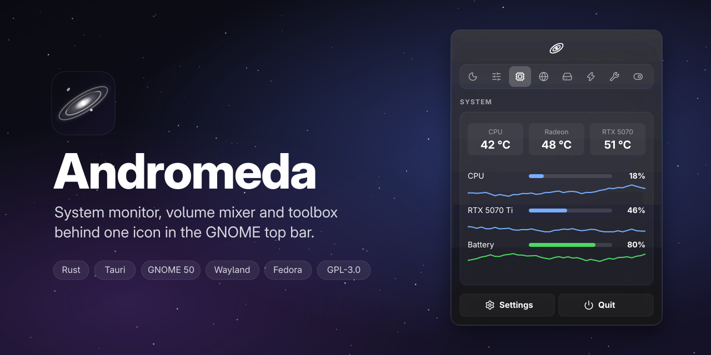

<div align="center">



**A system monitor, per-app volume mixer and toolbox for the GNOME top bar.**<br>
Built for Fedora GNOME on Wayland, written in Rust.

[](../../releases)
[](../../actions/workflows/ci.yml)
[](LICENSE)
[](https://fedoraproject.org/)
[](https://www.gnome.org/)

[Install](#install) · [Features](#features) · [Shortcuts](#keyboard-shortcuts) · [Troubleshooting](#troubleshooting) · [How it works](#how-it-works) · [Contributing](CONTRIBUTING.md)

</div>

## Install

Requires **Fedora 44+** with **GNOME 50** on **Wayland**.

**From a release (recommended):** download the RPM from the [latest release](../../releases) and run

```bash
sudo dnf install ./andromeda-*.rpm
```

**From source:**

```bash
git clone https://github.com/Incept0s/andromeda.git
cd andromeda
scripts/install.sh
```

The script installs the build tools (Rust with the WebAssembly target,
[Trunk](https://github.com/trunk-rs/trunk), WebKitGTK headers), builds an RPM
and installs it. Run it again to update; your settings are kept.

**After installing, once:**

1. Log out and back in. GNOME on Wayland only loads new extensions at login.
2. Open the **Extensions** app and switch on **Andromeda**.
3. Optional, for the frosted-glass blur: in
   [Blur My Shell](https://extensions.gnome.org/extension/3193/blur-my-shell/)
   → **Applications**, add `andromeda` to the whitelist.

To uninstall: `sudo dnf remove andromeda`.

## Features

One icon in the top bar opens a panel with eight tabs:

| Tab | What it does |
|-----|--------------|
| **System** | CPU, every GPU (AMD and Intel via the kernel, NVIDIA via its driver), memory and pressure, temperatures, fans, battery health, live graphs |
| **Volume mixer** | Per-app volume with boost above 100 %, mute, per-app output device, system output and microphone |
| **Network** | Live speed, session totals, interfaces and addresses, apps with open connections, speed test |
| **Disks** | Space per volume, read/write speed, drive health (SMART), eject |
| **Energy** | Battery and power flow, power mode, mouse and headset batteries, busiest apps |
| **Keep awake** | Blocks suspend and screen blanking for a set time; stops on its own when the battery runs low |
| **Tools** | Clipboard history (text and images), copy text from screen (OCR, QR codes), color picker, file converter, cleaner, RPM and Flatpak packages, shelf |
| **Controls** | Quick switches for background features |

In the top bar:

- **Live numbers**, e.g. `CPU 42°  RAM 61%  12W`, right of the clock or at the far left (Settings → Top bar).
- **Shelf**: drop files on the box icon to park them, click it to drag them out again. Entries expire after 24 h (configurable). Links only, nothing is copied or moved.
- **Converter** (optional): drop a file on the icon to convert it (WebP, JPEG, MP3, GIF, PDF, compress).
- **Clipboard** (optional): your recent copies; click one to copy it again.

On the desktop:

- **Alt+Tab** with large live previews grouped by app, and every window's title under its preview.
- **Alerts** as GNOME notifications when a reading stays past a limit you set.

Every feature can be switched off in Settings → Features. Missing hardware or
tools just hide what depends on them; Settings → System check lists what was found.

## Keyboard shortcuts

All shortcuts work in every app and can be changed in Settings → Shortcuts.

| Shortcut | Action |
|----------|--------|
| <kbd>Super</kbd>+<kbd>A</kbd> | Show or hide the panel |
| <kbd>Super</kbd>+<kbd>Shift</kbd>+<kbd>T</kbd> | Copy text (or a QR code) from a screen area |
| <kbd>Super</kbd>+<kbd>Shift</kbd>+<kbd>C</kbd> | Pick a color; its hex code is copied |
| <kbd>Super</kbd>+<kbd>Shift</kbd>+<kbd>K</kbd> | Keep awake on/off |
| <kbd>Super</kbd>+<kbd>Shift</kbd>+<kbd>M</kbd> | Microphone mute on/off |

Super+A is GNOME's "Show apps" shortcut by default; Andromeda borrows it while
the extension is on and gives it back when it is turned off.

## Requirements

| | |
|---|---|
| Required | Fedora 44+, GNOME 50, Wayland, PipeWire |
| Pulled in by the RPM | WebKitGTK, ffmpeg (`ffmpeg-free` works; RPM Fusion's adds H.264), Tesseract (English), curl |
| Used when present | LibreOffice, Flatpak, PackageKit, UDisks2, power-profiles-daemon or tuned-ppd, Blur My Shell |

There is no Flatpak and none is planned: a sandboxed app cannot read hardware
sensors, change other apps' volume or ship a Shell extension.

## Configuration and data

| Path | Contents |
|------|----------|
| `~/.config/io.github.incept0s.Andromeda/config.toml` | Settings (editable by hand; an unreadable file is moved to `config.toml.bad`) |
| `~/.local/share/io.github.incept0s.Andromeda/` | Clipboard history, clipboard images, shelf; readable by you only |

## Privacy

- **Nothing leaves your computer on its own.** The network is only used for the speed test (Cloudflare) and package operations you start.
- **Clipboard history stays local.** Copies that password managers mark as secret are never stored.
- **Screen text recognition** deletes its temporary screenshot right after reading it.
- **No permanent root.** A password is only asked for package changes (PackageKit) and the cleaner's system items (`pkexec`, fixed command list).

Security issues: see [SECURITY.md](SECURITY.md).

## Troubleshooting

**The icon does not appear.** Log out and back in, then switch Andromeda on in the Extensions app.

**A tab is empty or says "not available".** Settings → System check shows which sensor, service or tool is missing and how to get it.

**The desktop misbehaves after enabling the extension.** Switch to a text console with <kbd>Ctrl</kbd>+<kbd>Alt</kbd>+<kbd>F3</kbd>, log in and run:

```bash
systemctl --user stop andromedad
gnome-extensions disable andromeda@incept0s.github.io
```

Then return with <kbd>Ctrl</kbd>+<kbd>Alt</kbd>+<kbd>F2</kbd>, log out and back in.

**Reporting a bug.** [Open an issue](../../issues/new/choose) and attach
`journalctl --user -b | grep -i andromeda`. For missing or wrong sensors, also
attach the output of `cargo run -p andromeda-core --example probe` from a
source checkout.

## How it works

```
GNOME Shell extension (JS)  ──┐
                              ├── D-Bus ──  andromedad (Rust)  ──  /proc, /sys, PipeWire, NVML,
Panel: Tauri + Leptos (Rust) ─┘                                    UDisks2, PackageKit, portals
```

- **`andromedad`** does all measuring and every job. It samples once per
  second and publishes everything on the session bus. Expensive readings (NVIDIA,
  drive and Wi-Fi temperatures) only run often while someone looks.
- **The panel** is a [Tauri](https://tauri.app) app whose UI is written in
  Rust with [Leptos](https://leptos.dev) and compiled to WebAssembly. It only
  displays and exits a few minutes after it is closed.
- **The Shell extension** is kept minimal. It draws the top-bar items, places the
  panel under its icon, forwards clipboard changes, registers shortcuts and
  extends GNOME's own Alt+Tab. It stores nothing.

Repository layout and development setup: [CONTRIBUTING.md](CONTRIBUTING.md).

## Project status

**0.1.0 is a pre-release**, in daily use on Fedora 44 / GNOME 50 (AMD Radeon
610M + NVIDIA RTX 5070 Ti laptop). Intel GPUs and desktops without a battery
are untested; reports are welcome.

Known issues:

- [#2](../../issues/2): dragging files out of the shelf into Files is inconsistent
- [#3](../../issues/3): the clipboard history window does not work properly
- [#4](../../issues/4): readings are plausible but not yet verified one by one against reference tools

Known limits: Linux has no per-app energy figure, so the Energy tab ranks apps
by CPU use; per-app network traffic needs root, so the Network tab counts
open connections.

## Contributing

Bug reports and patches are welcome. See [CONTRIBUTING.md](CONTRIBUTING.md)
for building, testing the extension safely in a nested session, and the
project's rules.

## License

Copyright © 2026 Incept0s. Licensed under the **GNU General Public License
v3.0 or later**; see [LICENSE](LICENSE). Third-party components are listed in
[THIRD-PARTY.md](THIRD-PARTY.md) and [THIRD-PARTY-LICENSES.md](THIRD-PARTY-LICENSES.md).

Inspired by [Vorssaint Utils](https://github.com/vorssaint/vorssaint-utils);
not affiliated with or endorsed by Vorssaint. Two small pieces of logic are
adapted from its GPL-3.0-or-later source and marked as modified (see
THIRD-PARTY.md); everything else is a new implementation.
