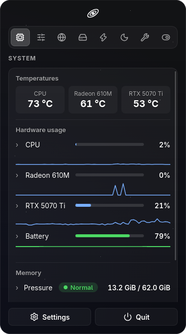
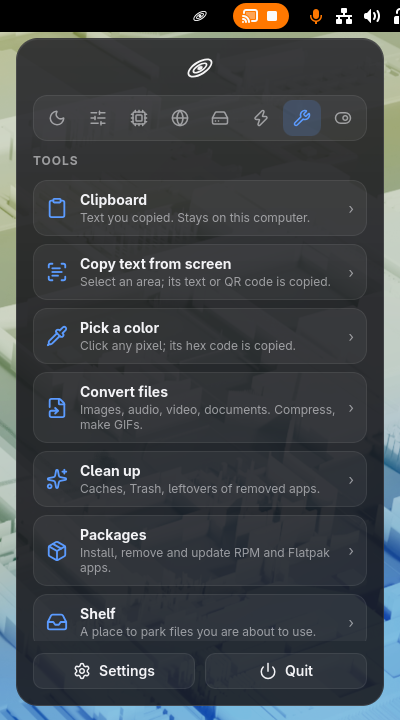
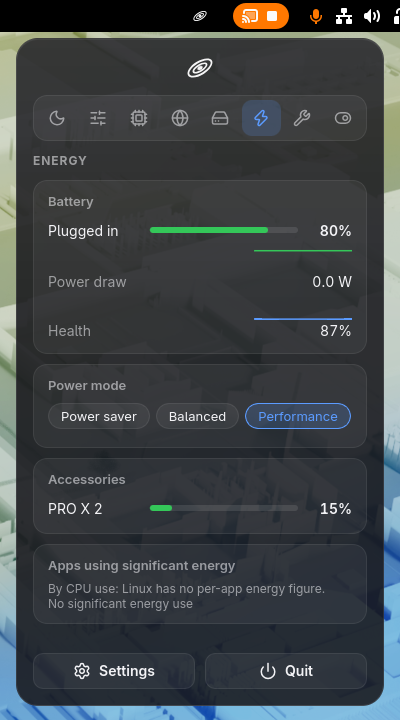
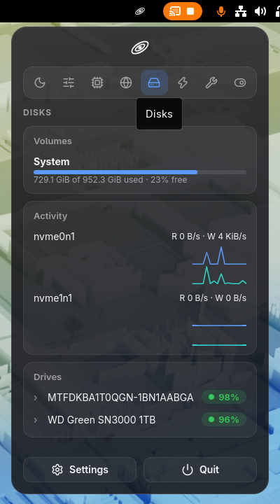
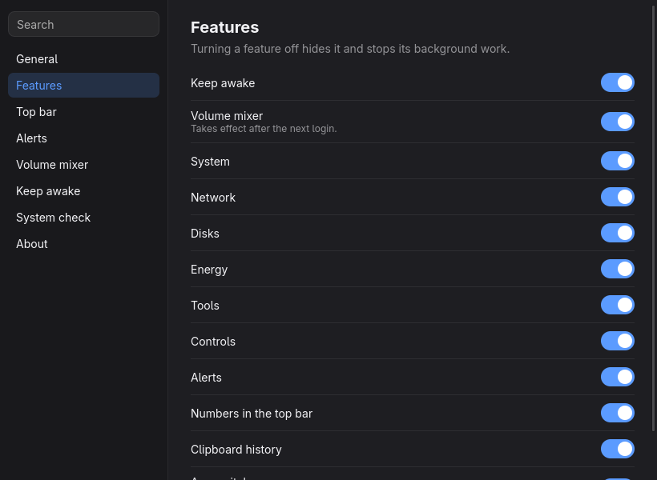

<div align="center">


# Andromeda

**A system monitor, volume mixer and toolbox behind one icon in the GNOME top bar.**

[](LICENSE)
[](https://fedoraproject.org/)
[](https://www.gnome.org/)
[](https://wayland.freedesktop.org/)
[](../../releases)

[](https://skillicons.dev)





</div>

## What this is

On macOS, a single menu-bar utility can show your temperatures, mix the volume
of every app separately, keep the computer awake, remember your clipboard and
pull text out of a screenshot. Andromeda brings that idea to GNOME: one icon in
the top bar with a few live numbers next to it, and a panel underneath with
everything else.

It is built for **Fedora GNOME on Wayland** and nothing else, so it can use
what that desktop actually offers: PipeWire for audio, systemd and D-Bus for
services, the GNOME Shell for the top bar and Alt+Tab. There is no tray icon
hack and no X11 fallback.

**Light when you are not looking.** A small background service does the
measuring (about 0.2 % of one CPU core and 28 MB of memory). The panel itself
only runs while it is open and quits a few minutes after you close it.

## What you get

| Tab | What it shows or does |
|-----|------------------------|
| **Keep awake** | Stops suspend and screen blanking for 15 min to "until I turn it off"; ends by itself when the battery runs low |
| **Volume mixer** | Volume per app, boost above 100 %, mute, a different output device per app, system output and microphone |
| **System** | CPU, every GPU (AMD and Intel from the kernel, NVIDIA through its driver), memory and memory pressure, temperatures, fans, battery health, uptime, graphs |
| **Network** | Live speed, session totals, interfaces and addresses, apps with open connections, an on-demand speed test |
| **Disks** | Space per volume, read/write speed, drive health (SMART), eject |
| **Energy** | Battery and power flow, power mode, accessory batteries (mouse, headset), the apps using the most CPU |
| **Tools** | Clipboard history, copy text from the screen (OCR and QR codes), color picker, file converter, cleaner, packages (RPM and Flatpak), a shelf for files |
| **Controls** | Quick switches for the app switcher and the background features |

Plus, outside the panel:

* **Top-bar numbers** — plain text, no graphs (`CPU 76°  RAM 28%  12W`). Pick
  and reorder them in Settings → Top bar.
* **Alt+Tab with large previews** — one live preview per window, minimized
  windows included, grouped by app.
* **Alerts** — a GNOME notification when any reading stays past a limit you
  set (CPU temperature, low battery, a nearly full disk, …).

Everything can be switched off in Settings → Features. Missing hardware or
tools only hide what needs them; Settings → System check shows what was found.

<div align="center">


</div>

## Download

Every [release](../../releases) has an RPM.

| Format | For | Install |
|--------|-----|---------|
| **RPM** | Fedora 44+ with GNOME 50 | `sudo dnf install ./andromeda-*.rpm` |

Then:

1. **Log out and back in once.** On Wayland, GNOME only loads a newly installed
   extension at login.
2. Open the **Extensions** app and switch on **Andromeda**.

The icon appears in the top bar, and the background service starts with every
login from now on.

A Flatpak is **not** planned: a sandboxed app cannot read hardware sensors,
change other apps' volume or add a GNOME Shell extension, which is most of what
Andromeda does.

### From source

```bash
git clone https://github.com/incept0s/andromeda.git
cd andromeda
scripts/install.sh
```

The script installs what it needs to build (Rust and its WebAssembly target,
[Trunk](https://trunkrs.dev), the WebKitGTK development files), builds an RPM
and installs it. Running it again updates Andromeda and keeps your settings.

## Requirements

* Fedora 44 or newer with **GNOME 50** on **Wayland**
* PipeWire (standard on Fedora) for the volume mixer
* Pulled in automatically by the RPM: WebKitGTK, ffmpeg (Fedora's
  `ffmpeg-free` is enough; RPM Fusion's `ffmpeg` adds H.264 video), Tesseract
  with English, curl
* Optional, detected when present: LibreOffice (documents to PDF and back),
  Flatpak, PackageKit, UDisks2, power-profiles-daemon or tuned-ppd

## Using it

Click the icon in the top bar, or press **Super+A**. The panel opens right
under the icon; click anywhere else or press **Escape** to close it.

* **Settings** (bottom left) has everything that is not a quick action:
  features, top-bar numbers, alerts, mixer limits, keep-awake options and the
  system check.
* **Quit** (bottom right) stops Andromeda completely, background service
  included. It starts again the next time you open the panel or log in.
* **Drop files on the panel** while the Tools tab is open: they land on the
  shelf, or in the converter if it is open.
* **Alt+Tab** shows the window switcher while the feature is on. Hold Alt and
  press Tab to move, W to close a window, release to switch.

Super+A is GNOME's "Show apps" shortcut by default; Andromeda takes it while
the extension is enabled and gives it back when you turn the extension off.
Show apps stays one click away on the dock and in the overview.

<div align="center">

</div>

## Where everything lives

```
/usr/bin/andromeda                    the panel (opened on demand)
/usr/libexec/andromedad               the background service
/usr/lib/systemd/user/andromedad.service
/usr/share/gnome-shell/extensions/andromeda@incept0s.github.io/

~/.config/io.github.incept0s.Andromeda/config.toml     your settings
~/.local/share/io.github.incept0s.Andromeda/clipboard.json
                                      clipboard history (readable by you only)
```

`config.toml` can be edited by hand. A file that cannot be read is moved to
`config.toml.bad` instead of being overwritten.

## Privacy and security

* **Nothing leaves your computer on its own.** The network is used only for
  things you start: the speed test (Cloudflare) and package searches, installs
  and updates (your repositories and Flathub).
* **Clipboard history** stays on disk with permissions for you alone. Entries
  that password managers mark as secret are never stored. Clear it any time,
  or switch it off in Settings → Features.
* **Copy text from screen** asks GNOME for a screenshot of the area you select;
  the picture is deleted as soon as the text is read.
* **No permanent root.** The service runs as you. A password is asked only for
  what needs it: installing or removing packages (PackageKit), and the
  cleaner's system items, which run one fixed command list through `pkexec`.
* **The cleaner never deletes without showing you first.** Only caches that
  rebuild themselves start selected; your files, the Trash and leftovers of
  removed apps wait for your tick.

To report a security problem, see [SECURITY.md](SECURITY.md).

## Troubleshooting

**The icon does not appear after installing.** Log out and back in, then
switch Andromeda on in the Extensions app. GNOME on Wayland cannot load a new
extension without a fresh login.

**A tab shows nothing or "not available".** Open Settings → System check: it
lists every sensor, service and tool Andromeda looked for and how to get the
missing ones.

**The desktop misbehaves after enabling the extension.** The extension runs
inside GNOME Shell, so a bug there affects the whole desktop. To recover:

1. Press **Ctrl+Alt+F3** and log in on the text console.
2. Stop the background service. Alt+Tab goes back to GNOME's own switcher
   right away, because Andromeda's only runs while the service does:

   ```bash
   systemctl --user stop andromedad
   ```

3. If the desktop is still not usable, switch the extension off:

   ```bash
   gnome-extensions disable andromeda@incept0s.github.io
   ```

   If that command hangs, remove the package: `sudo dnf remove andromeda`.
4. Press **Ctrl+Alt+F2** (or F1) to go back, then log out and in.

Please [open an issue](../../issues) with the output of
`journalctl --user -b | grep -i andromeda`.

**Sensors are missing or wrong on my hardware.** Run
`cargo run -p andromeda-core --example probe` in a source checkout and attach
the output to an issue. It lists every metric Andromeda found.

## How it works

* **A service that measures, a panel that shows.** `andromedad` (Rust) reads
  `/proc` and `/sys` directly, talks to PipeWire, UDisks2, PackageKit,
  power-profiles-daemon and the XDG portals over D-Bus, and asks NVIDIA's
  driver library for GPU numbers. It publishes everything on the session bus.
  The panel and the Shell extension only display what it sends.
* **The panel is Rust too, including its interface.** It is a
  [Tauri](https://tauri.app) app; the interface is written with
  [Leptos](https://leptos.dev) and compiled to WebAssembly, so the whole app
  has no hand-written JavaScript. A strict content policy lets it load only
  its own bundled files.
* **The Shell extension is as small as possible.** GNOME Shell only runs
  JavaScript, and only an extension can draw in the top bar, place a window
  under its icon, see clipboard changes from other apps or replace Alt+Tab on
  Wayland. It does exactly that and stores nothing; the window switcher builds
  on GNOME's own, so keyboard handling and window previews are GNOME's tested
  code.
* **Expensive readings only when someone looks.** Drive, Wi-Fi and RAM
  temperatures cost the kernel a device query each, and NVIDIA readings go
  through its driver, so they run every 10 seconds unless the panel is open or
  the top bar or an alert uses them.
* **Long jobs never block the service.** Conversions, package installs, OCR
  and the speed test run as background jobs that report back when done.

## Project status

Version 0.1, before the first public release.

| | |
|---|---|
| Tested | Fedora 44, GNOME 50, Wayland, AMD Radeon 610M + NVIDIA RTX 5070 Ti laptop; nested GNOME session for the extension |
| Should work | Other AMD and NVIDIA machines on Fedora 44+ with GNOME 50 |
| Untested | Intel GPUs (reports welcome), desktops without a battery |
| Packages | RPM, built by CI for every tagged release |
| Not planned | Flatpak, KDE, X11, other distributions (forks welcome) |

Known limits: Linux has no per-app energy figure, so the Energy tab ranks apps
by CPU use; per-app network traffic needs root, so the Network tab counts open
connections instead; files can be dropped onto the shelf but not yet dragged
back out.

## Contributing

Bug reports and patches are welcome — see [CONTRIBUTING.md](CONTRIBUTING.md).
If something in the panel confused you, that is a bug worth reporting too.

## License and credits

Andromeda is free software under the **GNU General Public License, version 3
or later** — see [LICENSE](LICENSE). Third-party components and their
licences are listed in [THIRD-PARTY.md](THIRD-PARTY.md); every Rust crate
compiled in is listed in [THIRD-PARTY-LICENSES.md](THIRD-PARTY-LICENSES.md).

**Inspired by [Vorssaint Utils](https://github.com/vorssaint/vorssaint-utils).** Two small pieces of logic are
adapted from its GPL-3.0-or-later source and marked as modified (see
THIRD-PARTY.md); everything else is a new implementation. Andromeda is an
independent project, not affiliated with or endorsed by Vorssaint, and uses
none of its name, logo or artwork.
